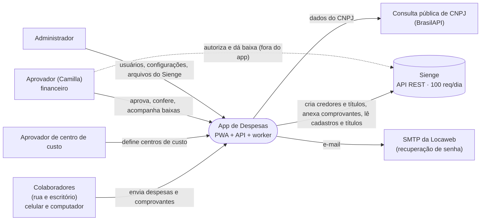
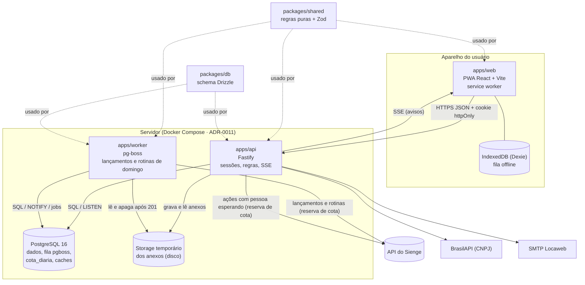

# Arquitetura — C4 níveis 1 e 2

Decisões detalhadas: [`docs/adr/`](../adr/README.md).

## Nível 1 — Contexto

## Nível 2 — Containers

Toda chamada ao Sienge, venha da API ou do worker, reserva a cota antes e é registrada em `chamadas_api` (ADR-0009).
