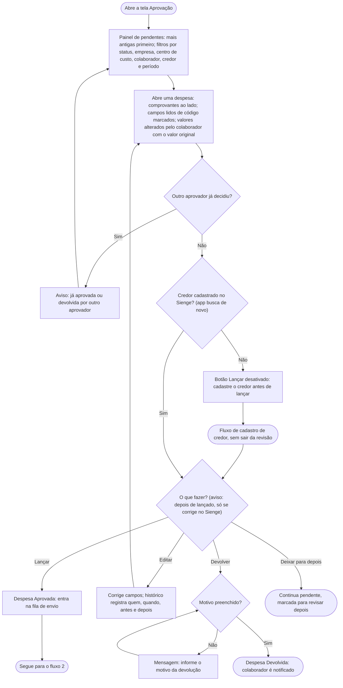
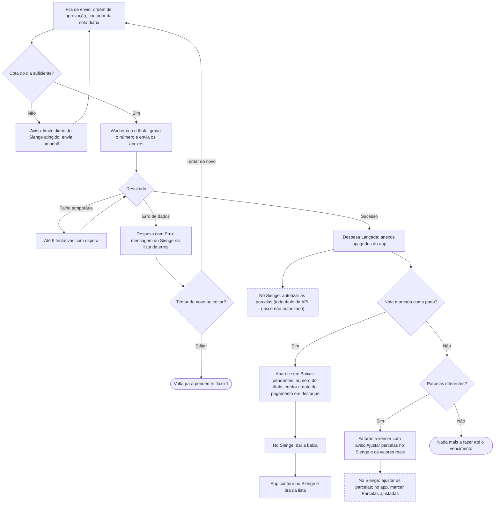

# Fluxo de usuário — Aprovação de título (aprovador, desktop)

Referências: `features/aprovacao-titulo.feature`, `features/baixas-pendentes.feature`, `features/integracao-sienge.feature`, SPEC §4, RF20–RF22, RF29, RN15, RN20.

Legenda: retângulo = tela ou ação do usuário; losango = decisão; arredondado = início ou fim; tracejado = acontece fora do app.

## 1. Revisão e decisão

## 2. Depois de lançar

## Observações para o wireframe

- Uso principal em desktop: lista de pendentes à esquerda e despesa aberta à direita (comprovante e dados lado a lado) evita abrir e fechar telas a cada uma das ~66 despesas do dia.
- Atalhos de teclado para as quatro decisões e para ir à próxima pendente aceleram a revisão em lote.
- O botão Lançar é a ação principal; Devolver pede o motivo num campo que já aparece aberto.
- Avisos que precisam estar visíveis na revisão: credor não cadastrado, parcelas diferentes, valor do boleto diferente do total, campos alterados pelo colaborador.
- Três listas apoiam o trabalho no Sienge depois do lançamento: erros de integração, Baixas pendentes e Faturas a vencer (com os ajustes de parcela).
