# Fluxo de usuário — Cadastro de título (colaborador, celular)

Referências: `features/cadastro-titulo.feature`, `features/cadastro-credor.feature`, SPEC RF06–RF15, RN01–RN13, RN21, RN22.

Legenda: retângulo = tela ou ação do usuário; losango = decisão; arredondado = início ou fim.

```mermaid
flowchart TD
  inicio(["Toca em Nova despesa"]) --> modo{"Como quer começar?"}
  modo -->|Escanear| scan["Câmera: QR da NFC-e, código do DANFE ou boleto"]
  modo -->|Digitar| empresa
  modo -->|Importar planilha| planilha(["Fluxo de importação de planilha"])

  scan --> tipoCodigo{"Que código foi lido?"}
  tipoCodigo -->|Chave NF-e ou NFC-e| leuChave["Preenche credor pelo CNPJ, número, tipo DANF e mês da emissão"]
  tipoCodigo -->|Boleto| leuBoleto["Preenche valor e vencimento da parcela"]
  tipoCodigo -->|Não reconhecido| naoLeu["Aviso: código não reconhecido"]
  leuChave --> dupChave{"Chave já enviada?"}
  dupChave -->|Sim| bloqueioDup["Bloqueia: nota já enviada, com link para a existente"]
  dupChave -->|Não| outroCodigo
  leuBoleto --> outroCodigo{"Escanear outro código?"}
  naoLeu --> outroCodigo
  outroCodigo -->|Sim| scan
  outroCodigo -->|Não| empresa

  empresa["Empresa"] --> forma["Forma de pagamento"]
  forma --> comprovante["Tipo de comprovante: nota, nota de serviço, recibo ou nenhum"]
  comprovante --> tipoDoc["App calcula o tipo de documento: DANF, NFSE, REC, PAG ou REMB"]
  tipoDoc --> reembolso{"Reembolso sem nota?"}
  reembolso -->|Sim| credorColab["Credor = o próprio colaborador"]
  reembolso -->|Não| buscaCredor["Credor: busca por CNPJ, CPF ou nome"]
  buscaCredor --> achou{"Credor encontrado?"}
  achou -->|Sim| numero
  achou -->|Não| avisoCredor["Aviso: credor não cadastrado"]
  avisoCredor --> querCadastrar{"Cadastrar agora?"}
  querCadastrar -->|Sim| cadCredor(["Fluxo de cadastro de credor"]) --> numero
  querCadastrar -->|Não| numero
  credorColab --> numero

  numero["Número do documento e emissão; sem nota, número = dd/mm do pagamento"] --> valor["Valor total"]
  valor --> paga{"A nota já está paga?"}
  paga -->|Sim| dataPag["Data do pagamento; 1 parcela"]
  paga -->|Não| parcelas["Quantidade de parcelas e 1º vencimento; prévia do Sienge"]
  parcelas --> iguais{"Parcelas do boleto iguais à prévia?"}
  iguais -->|Sim| aprop
  iguais -->|Não| reais["Informa valor e vencimento reais; marca Ajustar parcelas no Sienge"]
  reais --> aprop
  dataPag --> aprop

  aprop["Apropriação: centro de custo da empresa + plano financeiro + valor"] --> saldo{"Saldo restante = 0?"}
  saldo -->|Não| aprop
  saldo -->|Sim| anexos["Anexos: foto ou arquivo, cada um com o tipo de documento"]
  anexos --> obs["Observação, opcional"]
  obs --> revisar["Revisar e tocar em Enviar"]
  revisar --> valido{"Tudo válido?"}
  valido -->|Não| erros["Mostra o que falta no próprio campo"] --> revisar
  valido -->|Sim| online{"Tem conexão?"}
  online -->|Não| fila["Guarda no aparelho: Aguardando envio"]
  fila -->|Conexão volta| servidor
  online -->|Sim| servidor{"Servidor: despesa duplicada?"}
  servidor -->|Sim| dupServidor["Aviso na tela Status despesas: já tinha sido enviada"]
  servidor -->|Não| pendente(["Despesa em análise: aparece na tela Status despesas"])
```

## Observações para o wireframe

- **Estrutura (decidida):** formulário único em seções, numa tela rolável, com o botão Enviar no fim.
- A leitura de código é local (decodifica a chave de acesso e o código do boleto): não usa certificado digital nem a API da SEFAZ. Valor total e data exata da nota continuam digitados.
- A leitura de código é o atalho principal: o botão de escanear deve ser o elemento mais visível da tela inicial.
- O colaborador pode ler mais de um código na mesma despesa (nota + boleto).
- O credor não cadastrado **não bloqueia** o envio; a pendência é resolvida na aprovação.
- Campos calculados (tipo de documento, data contábil, data base, número sem nota) não aparecem para digitação.
- Validações mostradas no campo, na hora: soma das apropriações, soma das parcelas, anexo sem tipo, data do pagamento ausente.
- Sem conexão, o envio nunca falha para o usuário: vai para a fila do aparelho.
