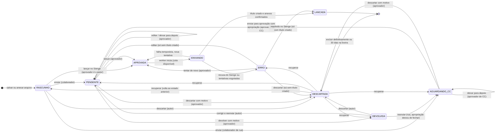
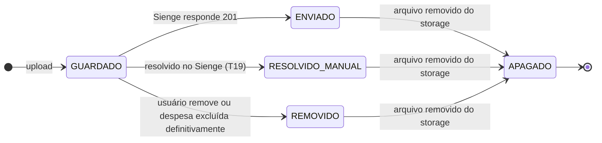
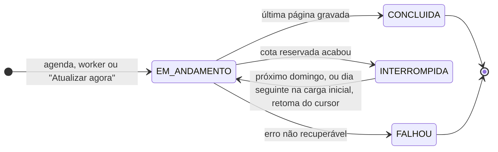

# 01 — Estados

Referências: SPEC §4, RF13, RF20–RF22, RF29, RF33–RF35, RN05, RN06, RN09, RN15, RN20, RN22, RN25; `aprovacao-titulo.feature`, `status-despesas.feature`, `integracao-sienge.feature`, `baixas-pendentes.feature`, `consulta-titulos.feature`.

## 1. Despesa

### 1.1 Estados

| Estado | Significado | Quem age | Grupo na tela Status (colaborador) |
|---|---|---|---|
| `RASCUNHO` | Despesa salva no servidor e ainda não enviada (ex.: anexos já carregados) | Autor | Não aparece nos grupos; o cadastro oferece "continuar rascunho" |
| `AGUARDANDO_CC` | Despesa de colaborador de rua esperando as apropriações (RN27) | Aprovador de centro de custo | Aguardando centro de custo |
| `PENDENTE` | Aguardando revisão de um aprovador | Aprovadores | Em análise |
| `DEVOLVIDA` | Voltou para o autor corrigir; motivo visível | Autor | Devolvidas |
| `APROVADA` | Na fila de lançamento (inclui "aguardando cota" e "nova tentativa agendada") | Worker | Aprovadas |
| `ENVIANDO` | Worker falando com o Sienge neste momento | Worker | Enviando ao Sienge |
| `LANCADA` | Título criado e todos os anexos no Sienge (ou resolvido manualmente) | — | Lançadas |
| `ERRO` | O Sienge recusou ou as tentativas acabaram | Aprovadores | Erro no lançamento |
| `DESCARTADA` | Na **lixeira** por 30 dias: pode ser recuperada ou excluída definitivamente; depois do prazo, é excluída sozinha | Quem descartou e aprovadores | Lixeira |

"Aguardando envio" (sem conexão) **não é um estado do servidor**: a despesa está só na fila do aparelho (IndexedDB) e ainda não existe no banco. Ao chegar, ela entra direto como `PENDENTE` (ou `APROVADA`, se o autor for aprovador), com as mesmas validações.

### 1.2 Transições

| # | De → Para | Gatilho | Quem | Condições (todas obrigatórias) | Efeitos |
|---|---|---|---|---|---|
| T1 | (nova) → `RASCUNHO` | Primeiro salvamento no servidor ou primeiro anexo enviado | Autor | Id da despesa gerado no cliente (`uuid`) | Cria a despesa; arquivos vão para o storage temporário |
| T2 | `RASCUNHO` → `PENDENTE` | "Enviar despesa" | Autor colaborador de escritório ou aprovador de centro de custo | Validações completas (V1–V8) e sem duplicidade (RN09) | Evento `ENVIADA`; aparece no painel dos aprovadores |
| T3 | `RASCUNHO` → `APROVADA` | "Lançar no Sienge" (RF34) | Autor aprovador | V1–V8, sem duplicidade e **credor cadastrado** | Eventos `ENVIADA` e `APROVADA` (aprovador = autor); enfileira o lançamento |
| T4 | `RASCUNHO` → `DESCARTADA` | "Descartar" | Autor | — | Evento `DESCARTADA`; vai para a lixeira (RN26) |
| T5 | `PENDENTE` → `PENDENTE` | "Salvar alterações" | Aprovador | `versao` igual à lida; V1–V8 | Evento `EDITADA` com antes e depois de cada campo; `versao + 1` |
| T6 | `PENDENTE` → `PENDENTE` | "Deixar para depois" | Aprovador | — | Marca `revisar_depois_em`; a despesa vai para o fim da fila do painel |
| T7 | `PENDENTE` → `APROVADA` | "Lançar no Sienge" | Aprovador | `versao` igual; V1–V8; **credor cadastrado** (`credor_id` preenchido) | Grava `aprovada_por_id` e `aprovada_em`; evento `APROVADA`; enfileira o lançamento |
| T8 | `PENDENTE` → `DEVOLVIDA` | "Devolver" | Aprovador | `versao` igual; motivo não vazio | Grava `motivo_devolucao`; evento `DEVOLVIDA` |
| T9 | `PENDENTE` → `DESCARTADA` | "Descartar" | Aprovador | Motivo não vazio | Evento `DESCARTADA`; vai para a lixeira |
| T10 | `DEVOLVIDA` → `PENDENTE` | "Corrigir e reenviar" | Autor | V1–V8 e sem duplicidade | Evento `REENVIADA`; o motivo anterior fica no histórico |
| T11 | `DEVOLVIDA` → `DESCARTADA` | "Descartar" | Autor | — | Evento `DESCARTADA`; vai para a lixeira |
| T12 | `APROVADA` → `ENVIANDO` | Worker pega o job | Sistema | Reserva de cota aceita para o custo estimado (1 título + 1 por anexo pendente + 1 se precisar conferir no Sienge), dentro do teto dos lançamentos; no domingo, só depois das rotinas curtas (ADR-0009) | `tentativas + 1`; evento `LANCAMENTO_INICIADO`. Sem cota: continua `APROVADA`, grava `aguardando_cota_desde`, avisa em amarelo e o job volta no início do próximo dia de cota, na ordem de aprovação (não conta como tentativa) |
| T13 | `ENVIANDO` → `LANCADA` | Título criado e último anexo confirmado | Sistema | `sienge_titulo_id` preenchido; todos os anexos `enviado_em` preenchido | Grava `lancada_em`; insere o título no cache (RN25); aviso verde; arquivos apagados |
| T14 | `ENVIANDO` → `APROVADA` | Falha temporária (rede, tempo esgotado, 5xx, 429) | Sistema | `tentativas < 5` | Reagenda com espera crescente; evento `RETENTATIVA`; aviso amarelo na primeira |
| T15 | `ENVIANDO` → `ERRO` | Recusa por dados (4xx) ou `tentativas = 5` | Sistema | — | Grava `erro_codigo` e `erro_mensagem` (o `clientMessage` do Sienge); evento `ERRO`; aviso vermelho |
| T16 | `ERRO` → `APROVADA` | "Tentar de novo" | Aprovador | — | Zera `tentativas`; enfileira. Se o título já existe, o worker envia só o que falta |
| T17 | `ERRO` → `PENDENTE` | "Editar despesa" | Aprovador | `sienge_titulo_id` **vazio** | Evento `EDITADA`; volta à revisão |
| T18 | `ERRO` → `DESCARTADA` | "Descartar" | Aprovador | `sienge_titulo_id` vazio; motivo não vazio | Evento `DESCARTADA`; vai para a lixeira |
| T19 | `ERRO` → `LANCADA` | "Resolvido no Sienge" | Aprovador | `sienge_titulo_id` **preenchido** | Anexos pendentes marcados como resolvidos manualmente; arquivos apagados; evento `RESOLVIDA_MANUALMENTE` |
| T22 | `RASCUNHO` → `AGUARDANDO_CC` | "Enviar despesa" | Autor colaborador de rua | V1–V3, V7, V8 e sem duplicidade; **sem** apropriações (V4–V6 não se aplicam) | Evento `ENVIADA`; aparece na fila "Definir centro de custo" |
| T23 | `AGUARDANDO_CC` → `AGUARDANDO_CC` | "Deixar para depois" | Aprovador de CC | — | Marca `revisar_depois_em` |
| T24 | `AGUARDANDO_CC` → `PENDENTE` | "Enviar para aprovação" | Aprovador de CC | `versao` igual; V4–V6 (apropriação completa, qualquer CC da empresa) | Grava `apropriacao_definida_por_id` e `apropriacao_definida_em`; evento `APROPRIACAO_DEFINIDA`; só os campos de apropriação mudam |
| T25 | `AGUARDANDO_CC` → `DESCARTADA` | "Descartar" | Aprovador | Motivo não vazio | Evento `DESCARTADA`; vai para a lixeira |
| T26 | `DEVOLVIDA` → `AGUARDANDO_CC` | "Corrigir e reenviar" | Autor colaborador de rua | V1–V3, V7, V8; as apropriações existentes **não** fecham com o novo total | Evento `REENVIADA`; volta para a fila de centro de custo (se fecharem, é T10 e vai para `PENDENTE`) |
| T20 | `DESCARTADA` → estado anterior | "Recuperar" | Quem descartou ou aprovador | Ainda na lixeira (menos de 30 dias); sem duplicidade com outra despesa ativa (RN09) | Volta para `status_antes_descarte`; evento `RECUPERADA` |
| T21 | `DESCARTADA` → (excluída) | "Excluir definitivamente" ou rotina diária após 30 dias | Quem descartou, aprovador ou sistema | — | Apaga a despesa, as linhas ligadas a ela e os arquivos do storage; não há como desfazer |

Também existe a retomada `ENVIANDO` → `ENVIANDO`: se o worker cair no meio do lançamento, a fila devolve o job depois do tempo limite e o worker continua de forma idempotente (ver [03-sequencias.md](03-sequencias.md), S5).

### 1.3 Validações (V1–V8)

| Código | Regra | Origem |
|---|---|---|
| V1 | Empresa, forma de pagamento, tipo de comprovante, credor (cadastrado ou CNPJ/CPF informado), número do documento, emissão e valor total preenchidos | RF09 |
| V2 | Nota paga → data do pagamento preenchida e 1 parcela; não paga → pelo menos 1 parcela com vencimento | RN21, RF13 |
| V3 | Soma das parcelas = valor total | RN06 |
| V4 | Pelo menos 1 apropriação; soma das apropriações = valor total | RN05 |
| V5 | Centro de custo da empresa da despesa, não oculto e permitido ao autor. Aprovador, aprovador de CC e qualquer usuário com a marcação de administrador: todos os da empresa (decidido em 06/11/2026) | RN07, RF11 |
| V6 | Plano financeiro selecionável: liberado no app, do grupo 2, `tp_conta = R`, `fl_redutora = N`, `fl_ativa = S` | RN08, RF37 |
| V7 | Pelo menos 1 anexo, todos com tipo (DANFe, NFSE, REC, PAG, REMB, COMP) | RN11 |
| V8 | Número do documento com até 20 caracteres; observação com até 500 | Sienge |

A duplicidade (RN09) é verificada à parte, porque bloqueia com um link para a despesa existente.

V4 a V6 dependem do perfil: o colaborador de rua envia **sem** apropriação; o colaborador de escritório só usa os CCs liberados para ele, salvo se for administrador; o aprovador de centro de custo, o aprovador e os administradores usam qualquer CC da empresa da despesa (não oculto).

### 1.4 Regras gerais

- A partir de `APROVADA`, só o worker muda o estado, exceto as ações do aprovador em `ERRO` (T16–T19).
- Toda transição feita por pessoa compara `versao`. Se mudou, a ação é recusada com "já decidida por outra pessoa" (cenário de dois aprovadores na mesma despesa).
- Toda transição grava um evento em `eventos_despesa`, com quem, quando e os dados relevantes.
- Estado final: `LANCADA`. Uma despesa lançada nunca volta: correções são feitas na tela do Sienge (títulos de origem `SE` não aceitam alteração pela API).
- `DESCARTADA` é a lixeira: a despesa some das listas, mas pode ser recuperada por 30 dias. A exclusão definitiva (manual ou automática) remove tudo.

## 2. Indicadores depois do lançamento

Não são estados: convivem com `LANCADA` e são independentes entre si.

| Indicador | Quando está ativo | Onde aparece | Como termina |
|---|---|---|---|
| Ajuste de parcelas pendente | `parcelas_diferentes = true` e `parcelas_ajustadas_em` vazio | Faturas a vencer (topo), revisão | "Parcelas ajustadas" com conferência no Sienge (S8) |
| Baixa pendente | `paga = true`, `baixa_confirmada_em` vazio e título não excluído | Baixas pendentes | Aprovador toca em "Já dei baixa" e confirma (v1: sem consulta ao Sienge, ADR-0009; a conferência pelas parcelas, S8, fica para a versão futura) |
| Título excluído no Sienge | `titulo_excluido_em` preenchido (404 numa conferência) | Histórico da despesa | — |

## 3. Anexo

Estados derivados das colunas de `anexos` (não há coluna de estado): `GUARDADO` = `caminho_storage` preenchido e nenhuma das datas abaixo; `ENVIADO` = `enviado_em`; `REMOVIDO` = `removido_em`; `RESOLVIDO_MANUAL` = `resolvido_manual_em`; `APAGADO` = `apagado_em`. O arquivo **nunca** é apagado antes do `201` daquele anexo (RN22). Despesa na lixeira mantém os arquivos, para poder ser recuperada; eles só saem na exclusão definitiva. A rotina diária apaga órfãos e repete exclusões que falharam.

## 4. Sincronização

Tipos: `CADASTROS` (domingo e "Sincronizar agora"), `CARGA_TITULOS` (uma vez, na implantação), `INCREMENTAL_TITULOS` (domingo e "Atualizar agora", com trava de 5 minutos: busca os títulos novos pelas últimas páginas do `GET /bills` e, no domingo, os alterados pelo `by-change-date`), `IMPORTACAO_CREDORES` (arquivo exportado do Sienge, enviado pelo administrador). Rotinas automáticas que chamam o Sienge só rodam aos domingos (ADR-0009). O cursor (`offset` da próxima página) fica gravado a cada página, para retomar sem repetir requisições.
