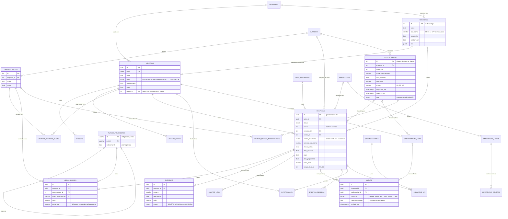

# 02 — Modelo entidade-relacionamento

Banco: PostgreSQL 16, com as extensões `citext` (e-mail sem diferenciar maiúsculas), `pg_trgm` (busca aproximada de nomes) e `unaccent` (busca sem acento). A fila de jobs (pg-boss) cria o próprio schema `pgboss` e não faz parte deste modelo.

## 1. Diagrama

O diagrama mostra as chaves e as colunas mais importantes. A lista completa de colunas está no dicionário (seção 3).

Tabelas de apoio sem relacionamento no diagrama: `CONFIGURACOES`, `COTA_DIARIA`.

## 2. Tipos enumerados

| Tipo | Valores |
|---|---|
| `perfil_usuario` | `COLABORADOR_RUA`, `COLABORADOR_ESCRITORIO`, `APROVADOR_CC`, `APROVADOR` (administrador é uma marcação à parte: `usuarios.administrador`) |
| `status_despesa` | `RASCUNHO`, `AGUARDANDO_CC`, `PENDENTE`, `DEVOLVIDA`, `APROVADA`, `ENVIANDO`, `LANCADA`, `ERRO`, `DESCARTADA` |
| `canal_despesa` | `CELULAR`, `COMPUTADOR`, `PLANILHA`, `CONFERENCIA` |
| `forma_pagamento` | `REEMBOLSO`, `CARTAO_CORPORATIVO`, `PIX_EMPRESA`, `BOLETO_PRAZO` |
| `tipo_comprovante` | `NOTA_FISCAL` (NF-e ou NFC-e), `NOTA_SERVICO`, `RECIBO`, `SEM_COMPROVANTE` |
| `tipo_anexo` | `DANFE`, `NFSE`, `REC`, `PAG`, `REMB`, `COMP` (enviado ao Sienge como `DANFe`, `NFSE`…) |
| `origem_parcela` | `BOLETO` (lida do código), `MANUAL` (digitada), `CALCULADA` (prévia do Sienge) |
| `origem_leitura` | `CHAVE_ACESSO`, `PDF`, `BOLETO`, `CONSULTA_CNPJ`, `PLANILHA` |
| `tipo_evento` | `CRIADA`, `ENVIADA`, `APROPRIACAO_DEFINIDA`, `EDITADA`, `REVISAR_DEPOIS`, `DEVOLVIDA`, `REENVIADA`, `APROVADA`, `DESCARTADA`, `RECUPERADA`, `LANCAMENTO_INICIADO`, `TITULO_CRIADO`, `ANEXO_ENVIADO`, `RETENTATIVA`, `AGUARDANDO_COTA`, `ERRO`, `LANCADA`, `RESOLVIDA_MANUALMENTE`, `PARCELAS_AJUSTADAS`, `BAIXA_CONFIRMADA`, `TITULO_EXCLUIDO` |
| `tipo_notificacao` | `LANCAMENTO_SUCESSO`, `LANCAMENTO_ERRO`, `LANCAMENTO_RETENTATIVA`, `DESPESA_DEVOLVIDA` |
| `tipo_sincronizacao` | `CADASTROS`, `IMPORTACAO_CREDORES`, `CARGA_TITULOS`, `INCREMENTAL_TITULOS` |
| `status_sincronizacao` | `EM_ANDAMENTO`, `CONCLUIDA`, `INTERROMPIDA`, `FALHOU` |
| `finalidade_chamada` | `LANCAMENTO`, `ANEXO`, `CREDOR`, `SINCRONIZACAO`, `CONFERENCIA`, `BAIXA`, `AJUSTE_PARCELAS`, `OUTRO` |
| `classe_cota` | `PESSOA`, `LANCAMENTO`, `ROTINA` (prioridade da reserva de cota, ADR-0009) |
| `situacao_linha` | `PRONTA`, `PRONTA_COM_AVISO`, `PROBLEMA` |
| `origem_escolha_cc` | `TEXTO`, `MANUAL`, `NAO_ENCONTRADO` |

## 3. Dicionário de dados

Colunas `criado_em` e `atualizado_em` (`timestamptz not null default now()`) existem em todas as tabelas do app e não são repetidas abaixo.

### 3.1 Acesso

**`usuarios`** — RF01–RF05, RN19

| Coluna | Tipo | Nulo | Regra |
|---|---|---|---|
| `id` | uuid | não | PK |
| `nome` | text | não | |
| `email` | citext | não | UK |
| `senha_hash` | text | não | Argon2id |
| `senha_provisoria` | boolean | não | `true` quando definida pelo administrador |
| `perfil` | perfil_usuario | não | padrão `COLABORADOR_ESCRITORIO` |
| `administrador` | boolean | não | padrão `false`; gerencia usuários e configurações |
| `ativo` | boolean | não | padrão `true` |
| `cpf_cifrado` | bytea | sim | CPF cifrado na aplicação (LGPD) |
| `cpf_final` | varchar(4) | sim | Só para exibir mascarado (`***.982.247-**`) |
| `chave_pix_cifrada` | bytea | sim | Cifrada na aplicação |
| `chave_pix_tipo` | varchar(10) | sim | `CPF`, `EMAIL`, `TELEFONE`, `ALEATORIA` |
| `municipio_id` | int | sim | FK `municipios` |
| `credor_id` | int | sim | FK `credores`; credor do colaborador no Sienge (RN14) |
| `ultimo_acesso_em` | timestamptz | sim | |

RF04 (pelo menos 1 administrador e 1 usuário com perfil `APROVADOR` ativos) é verificado na mesma transação de qualquer alteração de perfil, de `administrador` ou de `ativo`.

**`sessoes`** — sessões de login. `id` uuid PK; `usuario_id` FK; `token_hash` bytea UK (o token em si nunca é gravado); `expira_em`, `revogada_em` timestamptz; `user_agent` text; `ip` inet. Trocar a senha revoga as outras sessões (RN19).

**`tokens_senha`** — recuperação de senha por e-mail (RF01). `id` uuid PK; `usuario_id` FK; `token_hash` bytea UK; `expira_em` timestamptz (1 hora); `usado_em` timestamptz.

**`usuario_centros_custo`** — RF03. Só é consultada para `COLABORADOR_ESCRITORIO` sem a marcação de administrador; os perfis `APROVADOR_CC` e `APROVADOR` e qualquer usuário com `administrador = true` acessam todos os CCs (V5), e `COLABORADOR_RUA` não informa apropriação. PK (`usuario_id`, `centro_custo_id`); `concedido_por_id` FK `usuarios`; `concedido_em`.

### 3.2 Cadastros espelhados do Sienge

Chave primária = id do Sienge. `sincronizado_em` (timestamptz) em todas. O que some do Sienge numa sincronização não é apagado: fica `presente_no_sienge = false` (despesas antigas continuam referenciando).

**`empresas`** — `id` int PK; `nome` text; `nome_fantasia` text; `cnpj` varchar(14); `presente_no_sienge` boolean.

**`centros_custo`** — RN07

| Coluna | Tipo | Nulo | Regra |
|---|---|---|---|
| `id` | int | não | PK |
| `empresa_id` | int | não | FK `empresas` (a API já omite os sem empresa) |
| `nome` | text | não | |
| `cnpj` | varchar(14) | sim | |
| `oculto` | boolean | não | padrão `false`; marcado pelo administrador |
| `oculto_por_id` | uuid | sim | FK `usuarios` |
| `oculto_em` | timestamptz | sim | |
| `presente_no_sienge` | boolean | não | |

Índice: (`empresa_id`) onde `oculto = false and presente_no_sienge`. A sincronização nunca altera `oculto`.

**`planos_financeiros`** — RN08, RF37. Guarda a lista completa do Sienge (sincronizada); o que aparece no app é decidido por `liberado_no_app`. A sincronização nunca altera `liberado_no_app`.

| Coluna | Tipo | Nulo | Regra |
|---|---|---|---|
| `id` | varchar(12) | não | PK; código sem pontos (`2010402`), é o `paymentCategoriesId` |
| `nome` | text | não | |
| `codigo_formatado` | varchar(16) | não | `2.01.04.02` (1º dígito, depois pares) |
| `pai_id` | varchar(12) | sim | FK `planos_financeiros` (prefixo do código) |
| `nivel` | smallint | não | 1 a 4 |
| `tp_conta` | char(1) | não | `T` totalizadora, `R` resultado |
| `fl_redutora`, `fl_ativa`, `fl_adiantamento`, `fl_imposto` | char(1) | não | `S`/`N` |
| `liberado_no_app` | boolean | não | padrão `false`; curadoria dos aprovadores (RF37); carga inicial de `data/planos-financeiros-liberados.json` |
| `liberado_por_id`, `liberado_em` | uuid, timestamptz | sim | Quem liberou ou tirou do app, e quando |
| `selecionavel` | boolean | não | **gerada**: `liberado_no_app and tp_conta = 'R' and fl_redutora = 'N' and fl_ativa = 'S' and id like '2%'` |
| `presente_no_sienge` | boolean | não | |

**`tipos_documento`** — `id` varchar(4) PK (com `trim`: `PAG`, não `"PAG "`); `nome` text; `somente_numeros`, `considera_zeros_esquerda`, `bloqueia_numero_repetido`, `exige_chave`, `exige_anexo`, `bloqueia_vencimento`, `exige_unidade` boolean; `presente_no_sienge` boolean.

**`municipios`** — RN18. `id` int PK (código Sienge); `nome` text; `uf` char(2); `nome_normalizado` text (sem acento, maiúsculas). UK (`nome_normalizado`, `uf`). Carga a partir de `data/municipios-sienge.csv`.

**`credores`** — cache dos credores do Sienge. Carga pelo "Relatório de Credores" detalhado em PDF, enviado pelo administrador (`docs/importacao-credores.md`); depois, entram os criados pelo app e, sob demanda, os desconhecidos que aparecerem num título (`GET /creditors/{id}`)

| Coluna | Tipo | Nulo | Regra |
|---|---|---|---|
| `id` | int | não | PK (id do Sienge) |
| `nome` | text | não | Razão social (`trim`) |
| `nome_fantasia` | text | sim | |
| `tipo_pessoa` | char(1) | não | `F` ou `J` |
| `documento` | varchar(14) | sim | CPF (11) ou CNPJ (14, alfanumérico) sem máscara, maiúsculas |
| `fornecedor`, `colaborador`, `corretor` | boolean | não | De `supplier`, `employee`, `broker` |
| `ativo` | boolean | não | |
| `municipio_id` | int | sim | FK `municipios` |
| `raw` | jsonb | sim | Resposta completa da API (nulo quando veio do arquivo exportado) |
| `origem_carga` | varchar(10) | não | `ARQUIVO`, `API` ou `APP` |
| `criado_pelo_app_em` | timestamptz | sim | Preenchido quando o app criou o credor |

Índices: (`documento`); GIN trigram em `unaccent(nome)` para a busca por nome. Não é UK: o Sienge pode ter duplicatas antigas.

### 3.3 Despesas

**`despesas`**

| Coluna | Tipo | Nulo | Regra / origem |
|---|---|---|---|
| `id` | uuid | não | PK, gerado no cliente (idempotência do envio offline) |
| `autor_id` | uuid | não | FK `usuarios` |
| `canal` | canal_despesa | não | |
| `importacao_id` | uuid | sim | FK `importacoes` |
| `status` | status_despesa | não | padrão `RASCUNHO` |
| `versao` | integer | não | padrão 1; +1 a cada alteração |
| `empresa_id` | int | sim* | FK `empresas` |
| `forma_pagamento` | forma_pagamento | sim* | |
| `tipo_comprovante` | tipo_comprovante | sim* | |
| `tipo_documento_id` | varchar(4) | sim* | FK `tipos_documento`; calculado (RN01) |
| `credor_id` | int | sim | FK `credores`; obrigatório para aprovar (T3, T7) |
| `credor_documento` | varchar(14) | sim | CNPJ/CPF informado quando o credor ainda não existe |
| `credor_nome_informado` | text | sim | |
| `numero_documento` | varchar(20) | sim* | Formatado (RN10) ou `dd/mm` |
| `numero_normalizado` | varchar(20) | sim* | Para duplicidade (RN09): só dígitos, sem zeros à esquerda; `dd/mm` mantido |
| `chave_acesso` | char(44) | sim | |
| `data_emissao` | date | sim* | |
| `data_contabil` | date | sim* | = emissão (RN02) |
| `data_base` | date | sim* | 1º dia do mês da emissão (RN02) |
| `paga` | boolean | sim* | |
| `data_pagamento` | date | sim | Obrigatória se `paga` |
| `valor_total` | numeric(14,2) | sim* | > 0 |
| `desconto` | numeric(14,2) | não | padrão 0; ≥ 0 |
| `observacao` | varchar(500) | sim | Enviada como `" "` quando vazia (RN12) |
| `parcelas_diferentes` | boolean | não | padrão `false` |
| `parcelas_ajustadas_em` | timestamptz | sim | |
| `parcelas_ajustadas_por_id` | uuid | sim | FK `usuarios` |
| `revisar_depois_em` | timestamptz | sim | "Deixar para depois" |
| `apropriacao_definida_por_id`, `apropriacao_definida_em` | uuid, timestamptz | sim | Aprovador de CC que completou as apropriações (RN27) |
| `enviada_em` | timestamptz | sim | |
| `aprovada_por_id`, `aprovada_em` | uuid, timestamptz | sim | |
| `devolvida_por_id`, `devolvida_em`, `motivo_devolucao` | uuid, timestamptz, text | sim | |
| `descartada_por_id`, `descartada_em`, `motivo_descarte` | uuid, timestamptz, text | sim | Lixeira (RN26) |
| `status_antes_descarte` | status_despesa | sim | Estado para onde "Recuperar" volta |
| `exclusao_prevista_em` | date | sim | `descartada_em` + 30 dias; a rotina diária exclui as vencidas |
| `sienge_titulo_id` | int | sim | FK `titulos_sienge`, UK |
| `tentativas` | smallint | não | padrão 0 |
| `aguardando_cota_desde` | timestamptz | sim | |
| `ultima_tentativa_em` | timestamptz | sim | |
| `erro_codigo` | varchar(40) | sim | Ex.: `HTTP_400`, `TIMEOUT` |
| `erro_mensagem` | text | sim | `clientMessage` do Sienge |
| `lancada_em` | timestamptz | sim | |
| `baixa_confirmada_em`, `baixa_confirmada_por_id` | timestamptz, uuid | sim | RN20: "Já dei baixa" (v1, sem consulta ao Sienge, ADR-0009); `baixa_confirmada_por_id` FK `usuarios` |
| `baixa_verificada_em` | timestamptz | sim | Só na versão futura da RN20 (conferência no Sienge) |
| `titulo_excluido_em` | timestamptz | sim | 404 numa conferência |

\* Pode ser nulo só em `RASCUNHO` e `DESCARTADA`. Despesas em `AGUARDANDO_CC` têm todos esses campos, mas ainda podem não ter apropriações. Restrição: `check (status in ('RASCUNHO','DESCARTADA') or (empresa_id, forma_pagamento, tipo_comprovante, tipo_documento_id, numero_documento, numero_normalizado, data_emissao, data_contabil, data_base, paga, valor_total) is not null)` (todas preenchidas). Também: `check (paga is not true or data_pagamento is not null)`; `check (status <> 'LANCADA' or sienge_titulo_id is not null)`.

Índices:

| Índice | Para quê |
|---|---|
| UK parcial em (`chave_acesso`) onde `status not in ('RASCUNHO','DESCARTADA')` | Duplicidade por chave (RN09), segura mesmo com dois envios simultâneos |
| UK parcial em (`coalesce(credor_id::text, credor_documento)`, `numero_normalizado`, `data_emissao`, `valor_total`) onde `status not in ('RASCUNHO','DESCARTADA')` | Duplicidade sem chave (RN09) |
| (`status`, `revisar_depois_em` nulls first, `enviada_em`) | Painel de pendentes e fila de centro de custo (`AGUARDANDO_CC`), mais antigas primeiro |
| (`autor_id`, `data_emissao` desc) | Tela Status, filtro por mês |
| Parcial em (`lancada_em`) onde `status = 'LANCADA' and paga and baixa_confirmada_em is null and titulo_excluido_em is null` | Baixas pendentes |
| Parcial em (`lancada_em`) onde `parcelas_diferentes and parcelas_ajustadas_em is null` | Ajustes de parcelas |
| (`credor_id`, `valor_total`) onde `status not in ('LANCADA','DESCARTADA')` | Conferência de notas: despesas ainda não lançadas |
| Parcial em (`exclusao_prevista_em`) onde `status = 'DESCARTADA'` | Lixeira e exclusão automática |

A soma das apropriações e a das parcelas (= `valor_total`) são validadas na mesma transação que muda o estado (V3, V4), com bloqueio da linha da despesa (`select … for update`).

**`apropriacoes`** — RN05. `id` uuid PK; `despesa_id` FK (cascata); `ordem` smallint; `centro_custo_id` int FK; `plano_financeiro_id` varchar(12) FK (só `selecionavel`); `valor` numeric(14,2) > 0; `percentual` numeric(15,12), calculado e congelado no lançamento. UK (`despesa_id`, `ordem`) e UK (`despesa_id`, `centro_custo_id`, `plano_financeiro_id`).

**`parcelas`** — parcelas **reais** (as do boleto). `id` uuid PK; `despesa_id` FK (cascata); `numero` smallint (1 a 840); `vencimento` date; `valor` numeric(14,2) > 0; `origem` origem_parcela; `linha_digitavel` varchar(48) (só dígitos: 47 do boleto bancário, 48 de convênio); `codigo_barras` char(44). UK (`despesa_id`, `numero`). As parcelas que o Sienge gera não são gravadas: são recalculadas (`PlanoParcelas.previaSienge`).

**`campos_lidos`** — RF07 ("valor original guardado"). `id` uuid PK; `despesa_id` FK (cascata); `campo` varchar(40) (`credor_documento`, `numero_documento`, `modelo`, `mes_emissao`, `parcela_valor`, `parcela_vencimento`, …); `parcela_numero` smallint; `valor_lido` text; `origem` origem_leitura; `lido_em` timestamptz. A revisão compara com o valor atual para mostrar "alterado pelo colaborador".

**`anexos`** — RF08, RN11, RN22

| Coluna | Tipo | Nulo | Regra |
|---|---|---|---|
| `id` | uuid | não | PK |
| `despesa_id` | uuid | sim | FK `despesas` |
| `conferencia_id` | uuid | sim | FK `conferencias_nota` |
| `nome_original` | text | não | Como veio do aparelho |
| `nome_envio` | varchar(100) | não | Nome enviado ao Sienge (limite de 100) |
| `tipo_mime` | varchar(100) | não | Imagem ou PDF |
| `tamanho_bytes` | bigint | não | ≤ 70 MB |
| `hash_sha256` | char(64) | não | |
| `descricao` | tipo_anexo | não | |
| `caminho_storage` | text | sim | Nulo depois de apagado |
| `enviado_em` | timestamptz | sim | `201` do Sienge |
| `sienge_attachment_id` | int | sim | Quando conhecido |
| `resolvido_manual_em` | timestamptz | sim | T19 |
| `removido_em` | timestamptz | sim | Removido pelo usuário ou despesa descartada |
| `apagado_em` | timestamptz | sim | Arquivo apagado do storage |
| `criado_por_id` | uuid | não | FK `usuarios` |

Restrição: `check (num_nonnulls(despesa_id, conferencia_id) = 1)` (pertence a uma despesa **ou** a uma conferência).

**`eventos_despesa`** — auditoria. `id` bigserial PK; `despesa_id` FK; `usuario_id` FK (nulo = sistema); `tipo` tipo_evento; `de_status`, `para_status` status_despesa; `dados` jsonb (antes e depois dos campos editados, motivo, número do título, resumo da resposta do Sienge); `criado_em`. Índice (`despesa_id`, `criado_em`). Só inserção; nunca alterado.

**`notificacoes`** — RF33. `id` uuid PK; `usuario_id` FK; `tipo` tipo_notificacao; `despesa_id` FK; `sienge_titulo_id` int; `mensagem` text; `exibida_em`, `fechada_em` timestamptz. O aviso verde "Título N lançado" vai para quem aprovou.

### 3.4 Importação e conferência

**`importacoes`** — §9. `id` uuid PK; `usuario_id` FK; `arquivo_nome` text; `linhas_total`, `linhas_prontas`, `linhas_com_problema` int; `importada_em` timestamptz (nulo enquanto na conferência).

**`importacao_linhas`** — `id` uuid PK; `importacao_id` FK (cascata); `codigo` varchar(20) (coluna "Código" da planilha); `numero_linha` int; `situacao` situacao_linha; `mensagem` text; `dados` jsonb (linha original); `despesa_id` FK (depois de importar).

**`importacao_centros`** — RN24. `id` uuid PK; `linha_id` FK (cascata); `texto_planilha` text; `centro_custo_id` int FK (nulo = não encontrado); `origem` origem_escolha_cc. Guarda se o usuário trocou a escolha do app (base para medir uma futura sugestão por IA).

**`conferencias_nota`** — RF30, RN23. `id` uuid PK; `usuario_id` FK; `credor_id` int FK; `credor_documento` varchar(14); `valor` numeric(14,2); `data_emissao`, `data_pagamento`, `periodo_inicio`, `periodo_fim` date; `titulos_encontrados` int[]; `titulo_escolhido_id` int FK `titulos_sienge`; `despesa_criada_id` uuid FK `despesas`; `concluida_em` timestamptz.

### 3.5 Cache do Sienge e integração

**`titulos_sienge`** — RN25, RF35

| Coluna | Tipo | Nulo | Campo da API |
|---|---|---|---|
| `id` | int | não | `id` (PK, número do título) |
| `empresa_id` | int | não | `debtorId` (FK `empresas`) |
| `credor_id` | int | não | `creditorId` (sem FK: o credor pode chegar depois) |
| `tipo_documento_id` | varchar(4) | não | `documentIdentificationId` (`trim`) |
| `numero_documento` | varchar(20) | sim | `documentNumber` |
| `data_emissao` | date | não | `issueDate` |
| `parcelas_qtd` | smallint | não | `installmentsNumber` |
| `valor_total` | numeric(14,2) | não | `totalInvoiceAmount` |
| `desconto` | numeric(14,2) | não | `discount` |
| `observacao` | text | sim | `notes` |
| `consistencia` | char(1) | sim | `status` (`S` = completo) |
| `origem` | varchar(4) | não | `originId` (`CP` tela, `FP` folha, `SE` API) |
| `registrado_por` | text | sim | `registeredBy` |
| `registrado_em` | timestamptz | não | `registeredDate` (fuso de São Paulo) |
| `alterado_por` | text | sim | `changedBy` |
| `alterado_em` | timestamptz | sim | `changedDate` |
| `chave_acesso` | char(44) | sim | `accessKeyNumber` |
| `raw` | jsonb | não | Resposta completa |
| `sincronizado_em` | timestamptz | não | |
| `excluido_em` | timestamptz | sim | 404 numa conferência |

Índices: (`registrado_em` desc, `id` desc) para a ordem padrão da tela Títulos; (`credor_id`, `data_emissao`); (`data_emissao`); (`numero_documento`); (`alterado_em`). Títulos de todas as origens aparecem, inclusive `FP`. Tamanho estimado: cerca de 22 MB para os 16,5 mil títulos atuais.

**`titulos_sienge_apropriacoes`** — RN28 (filtro e total por centro de custo na tela Títulos). `titulo_id` int FK `titulos_sienge` (cascata); `ordem` smallint; `centro_custo_id` int FK; `plano_financeiro_id` varchar(12); `percentual` numeric(15,12); `valor` numeric(14,2) (= valor do título × percentual, calculado ao gravar); `origem` varchar(10) (`APP`, `RELATORIO` ou `API`). PK (`titulo_id`, `ordem`). Índice (`centro_custo_id`, `titulo_id`). Títulos lançados pelo app gravam as linhas no lançamento; o histórico vem do relatório "Contas pagas com apropriações" (`docs/importacao-apropriacoes.md`); títulos em aberto lançados direto no Sienge, por `GET /bills/{id}/budget-categories`.

**`sincronizacoes`** — `id` uuid PK; `tipo` tipo_sincronizacao; `status` status_sincronizacao; `disparada_por_id` uuid FK (nulo = agenda); `iniciada_em`, `concluida_em` timestamptz; `periodo_inicio`, `periodo_fim` timestamptz; `cursor_offset` int; `total_esperado` int (`count` da 1ª página); `itens_gravados` int; `requisicoes` int; `erro` text. A trava de 5 minutos do "Atualizar agora" é a última linha `INCREMENTAL_TITULOS` disparada por pessoa, com `iniciada_em` há menos de 5 minutos.

**`chamadas_api`** — `id` bigserial PK; `ocorrida_em` timestamptz; `dia_cota` date (fuso de São Paulo); `metodo` varchar(7); `caminho` text (sem dados pessoais: `/bills/{id}`); `status_http` smallint; `duracao_ms` int; `finalidade` finalidade_chamada; `classe` classe_cota; `despesa_id` FK; `sincronizacao_id` FK; `erro_resumo` text. Índice (`dia_cota`).

**`cota_diaria`** — `dia` date PK (dia civil de São Paulo); `limite` int; `usadas` int. A requisição é **reservada antes** de ser feita, de forma atômica e com o teto da classe da chamada (ADR-0009): `update cota_diaria set usadas = usadas + $2 where dia = $1 and usadas + $2 <= $3 returning usadas`, com `$3` = `limite` para `PESSOA` e `limite − cota_reserva_pessoas` para `LANCAMENTO` e `ROTINA`. Sem linha retornada, não chama a API.

**`configuracoes`** — `chave` varchar(60) PK; `valor` jsonb; `atualizado_por_id` FK. Chaves: `limite_diario_api` (100), `cota_reserva_pessoas` (10), `rotinas_dia_semana` (0 = domingo), `conferencia_margem_dias` (3), `atualizar_titulos_intervalo_min` (5). O `.env` traz os valores iniciais; a tela de configurações altera os editáveis.

## 4. Retenção e dados pessoais (LGPD)

| Dado | Onde | Cuidado |
|---|---|---|
| CPF e chave Pix do colaborador | `usuarios` | Cifrados na aplicação; exibidos mascarados |
| Comprovantes | storage temporário | Apagados depois do `201` (RN22) ou na exclusão definitiva da lixeira; fora do backup |
| Tokens de sessão e de senha | `sessoes`, `tokens_senha` | Só o hash é gravado |
| Chamadas à API | `chamadas_api` | Caminho sem documento nem nome; sem corpo da requisição |
| Credores | `credores` | Dados de cadastro do Sienge; CPF de pessoa física fica no `raw` e no `documento` |
