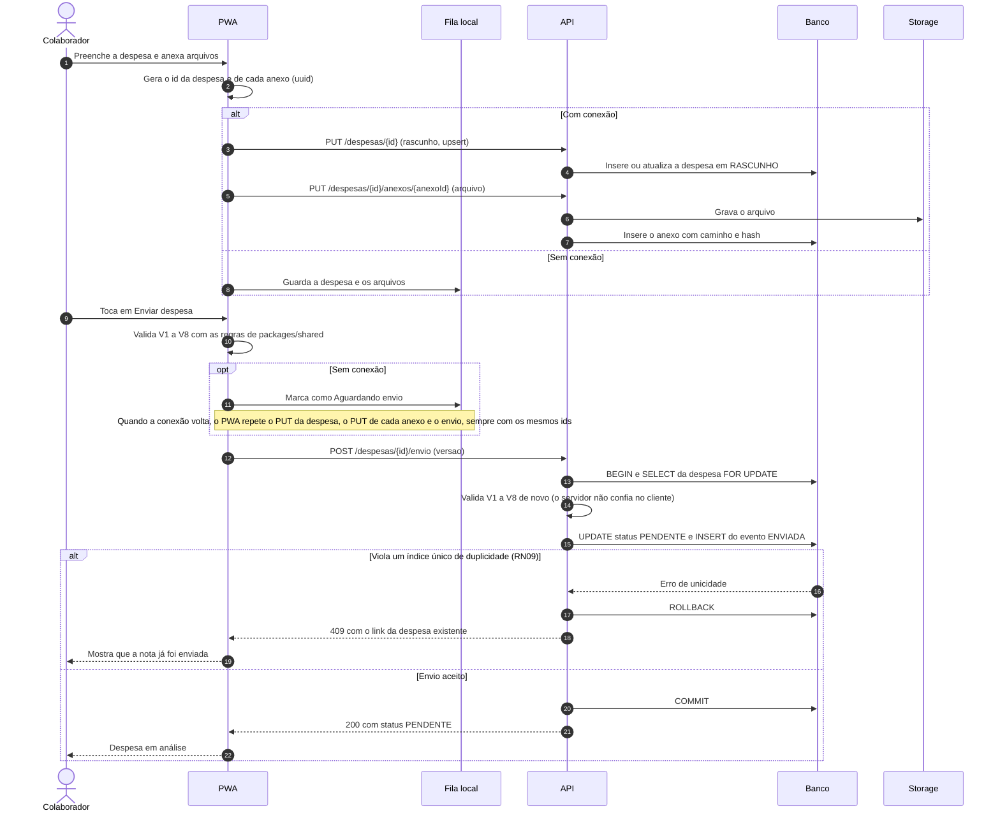
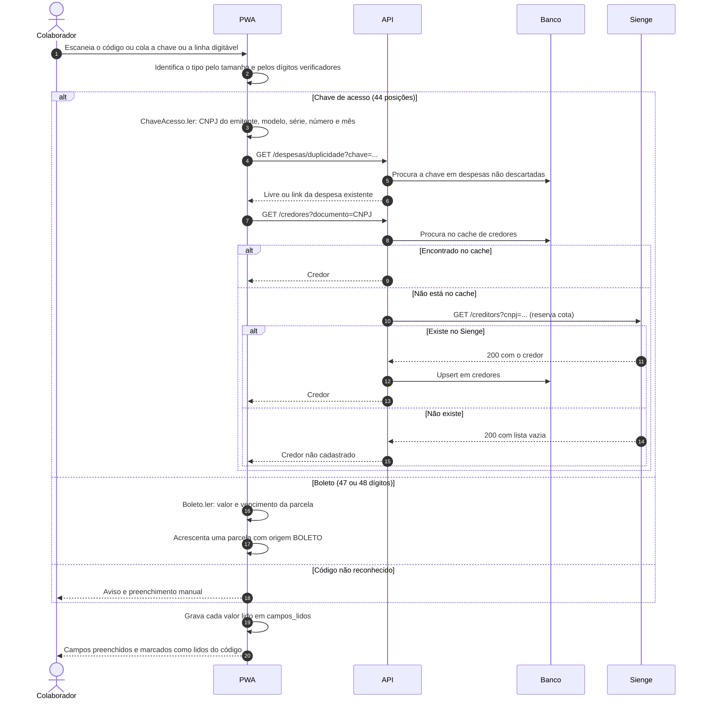
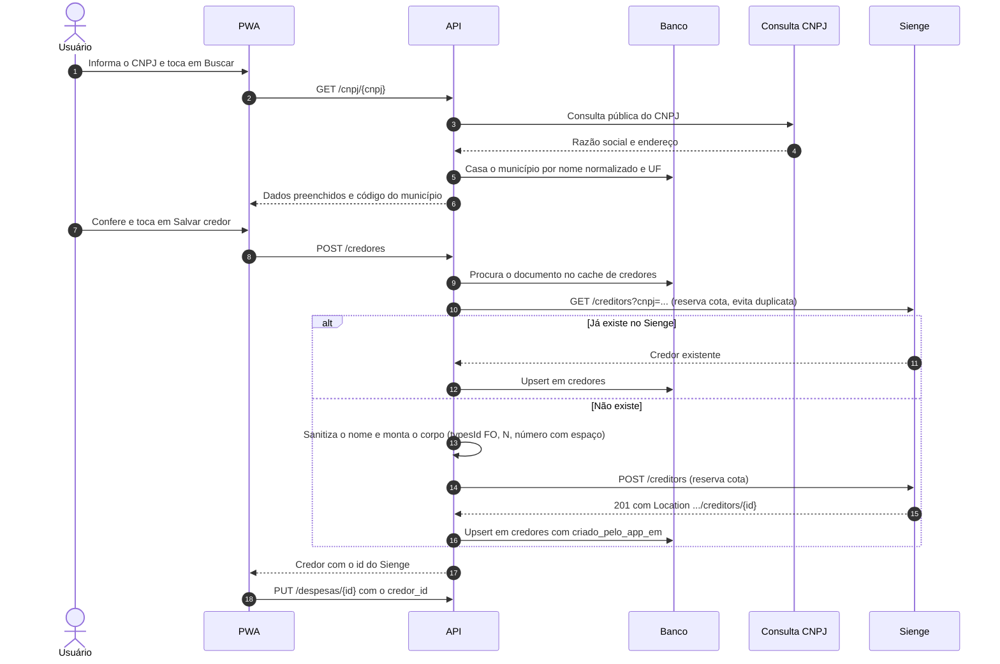
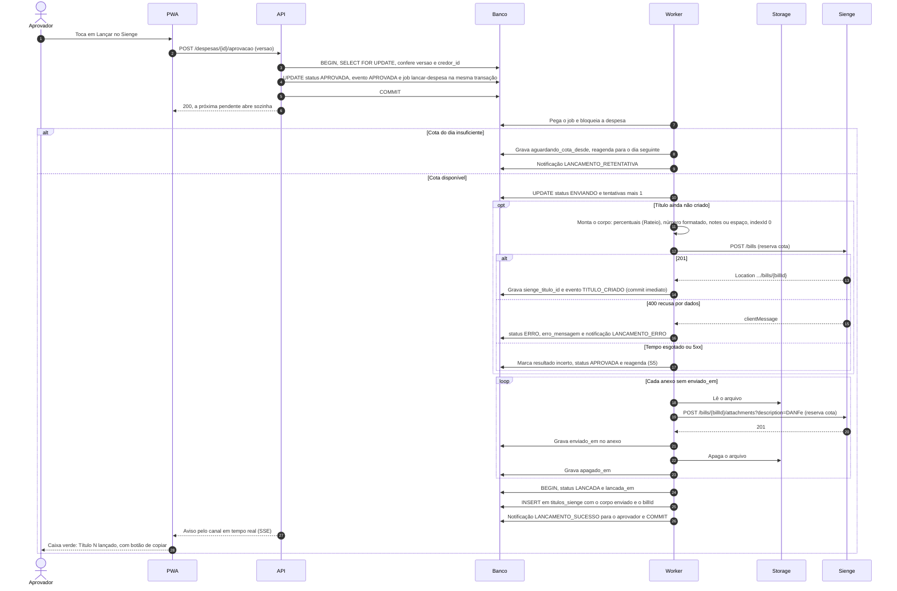
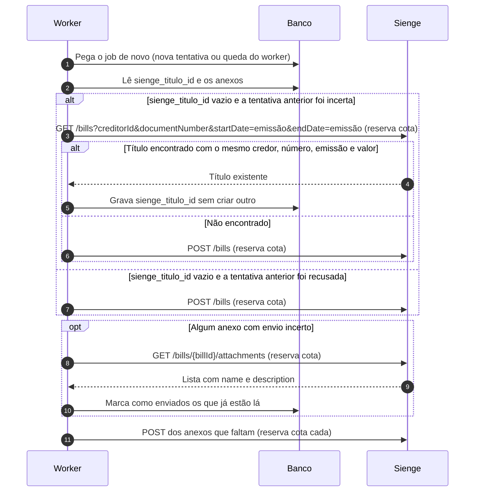
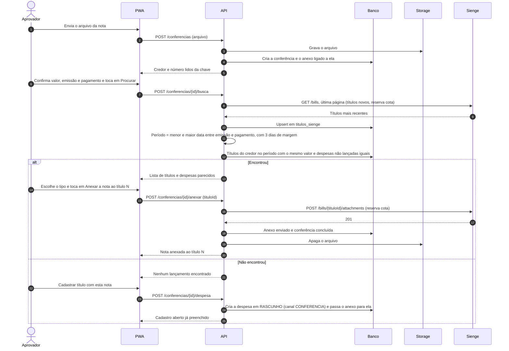
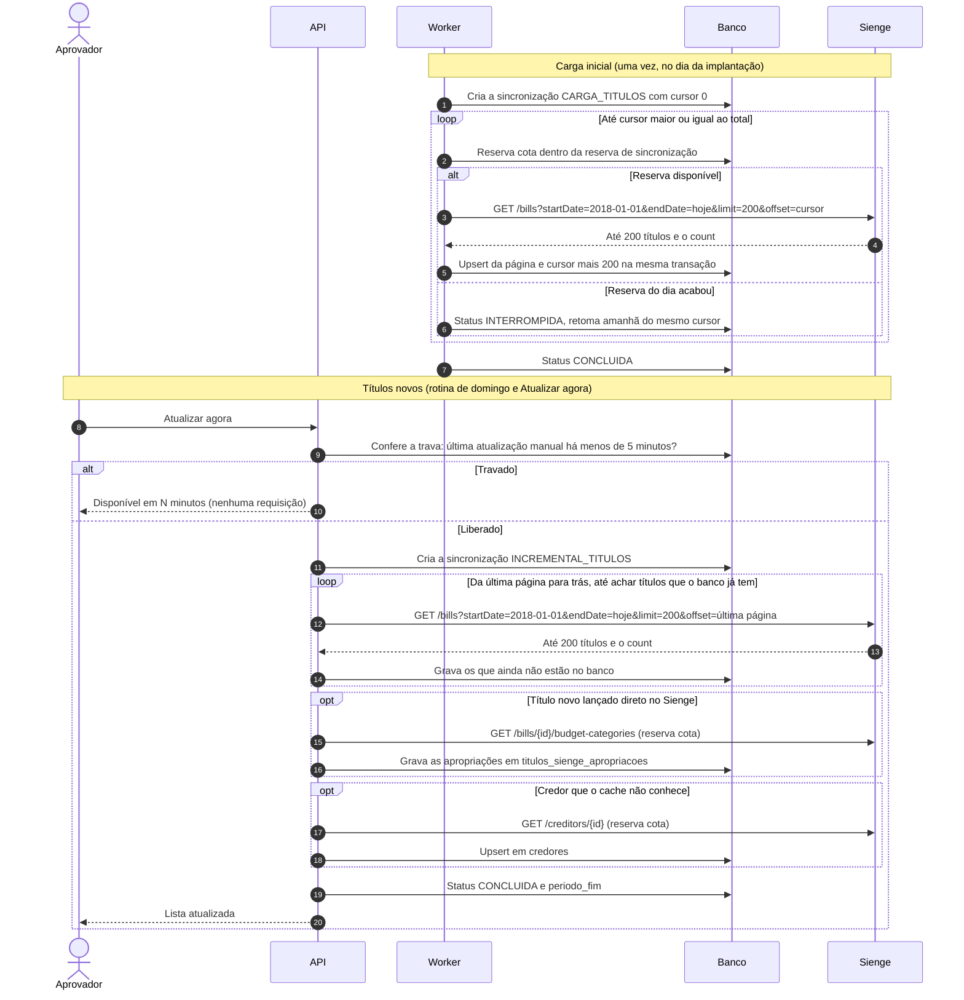
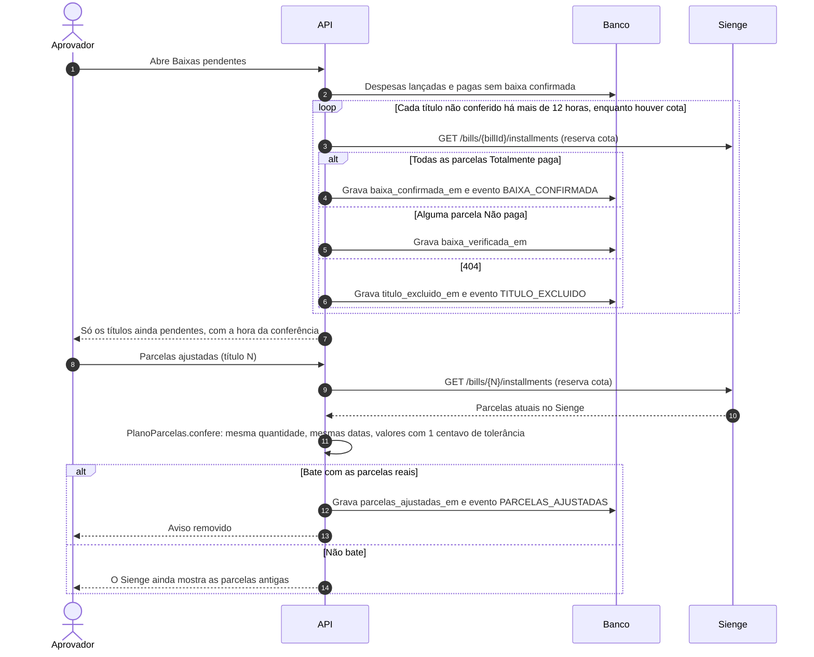
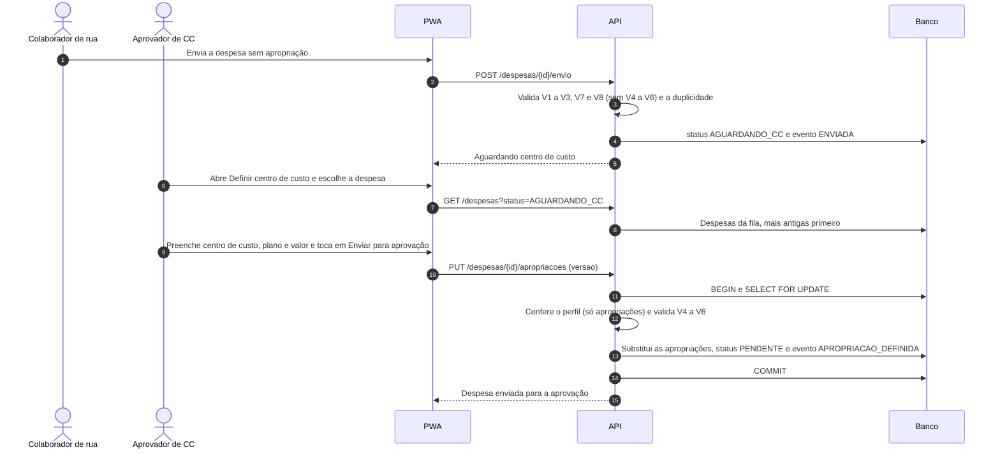

# 03 — Sequências

Participantes usados em todos os diagramas:

| Participante | O que é |
|---|---|
| PWA | `apps/web` (celular ou computador) |
| Fila local | IndexedDB do aparelho (despesas e arquivos enquanto não há conexão) |
| API | `apps/api` (Fastify) |
| Banco | PostgreSQL, incluindo a fila de jobs (pg-boss) |
| Storage | Armazenamento temporário dos comprovantes |
| Worker | `apps/worker`, único que fala com o Sienge em segundo plano |
| Sienge | API REST do Sienge (cota de 100 requisições por dia) |
| Consulta CNPJ | API pública de CNPJ (ex.: BrasilAPI) |

Toda chamada ao Sienge passa antes pela reserva atômica em `cota_diaria` e é registrada em `chamadas_api`. Para não repetir, os diagramas mostram a reserva só como "reserva cota".

## S1 — Cadastro e envio da despesa (com e sem conexão)

RF06–RF15, RN09, `cadastro-titulo.feature`.

Idempotência: o `PUT` da despesa e dos anexos é um upsert pelo id gerado no cliente, e repetir o envio de uma despesa que já está `PENDENTE` devolve `200` com o estado atual. Assim, a fila do aparelho pode reenviar tudo sem criar duplicatas. Se o autor for aprovador, o passo 15 grava `APROVADA` e enfileira o lançamento (T3); dali em diante, o fluxo é o de S4 a partir do passo 7.

## S2 — Leitura de código e busca do credor

RF06, RF07, §7, RN09.

A leitura é toda local (sem SEFAZ e sem certificado). A única chamada ao Sienge acontece quando o credor ainda não está no cache.

## S3 — Cadastro de credor

RF16–RF18, RN13, RN17, RN18, `cadastro-credor.feature`.

O credor do colaborador (RN14) usa o mesmo fluxo a partir do passo 8, com `personType F`, `typesId FU` e os dados do cadastro do usuário. A atualização usa `PATCH /creditors/{id}`, que é aceito em credores criados pela API.

## S4 — Aprovação e lançamento

RF20–RF22, RF33, RN05, RN12, RN16, RN22, T7, T12–T15.

O `sienge_titulo_id` é gravado **antes** dos anexos, numa transação própria: se o worker cair depois disso, a retomada nunca cria um segundo título. Nenhuma chamada de alteração (`PATCH`/`PUT`) é feita no título.

## S5 — Retomada idempotente depois de falha incerta

`integracao-sienge.feature`, "Uma despesa nunca gera dois títulos".

A busca do passo 3 só acontece quando a tentativa anterior pode ter chegado ao Sienge (tempo esgotado ou 5xx depois do envio). Uma recusa clara (4xx) não deixa título criado, então não gasta essa requisição.

## S6 — Conferência de notas

RF30, RN23, RN25, `conferencia-notas.feature`.

O título encontrado não é alterado: a nota entra só como anexo. Ponto de teste: anexar em títulos lançados pela tela (origem `CP`).

## S7 — Cache de títulos e de credores

RN25, RF35, `consulta-titulos.feature`.

Detalhes:
- A lista vem em ordem crescente de id e cada título novo entra no fim, então paginar por `offset` não pula títulos enquanto a carga acontece. O que mudar durante a carga entra na primeira atualização incremental.
- Os títulos novos ficam no fim da lista: a rotina começa pela última página (`offset = count − 200`) e volta página por página enquanto todos os títulos forem novos. Alterações em títulos antigos não entram por essa rotina (ver RN25 c).
- Credores: a carga inicial vem do **arquivo exportado do Sienge** (o administrador envia em Configurações; nenhuma requisição). Depois, os criados pelo app entram na hora, e um credor desconhecido que apareça num título é buscado sob demanda (passos do `opt`, 1 requisição cada, raro). O administrador pode reenviar o arquivo quando quiser atualizar tudo.

## S8 — Conferência de baixa e de ajuste de parcelas

RN20, RF13, RF29, `baixas-pendentes.feature`, `aprovacao-titulo.feature`.

**v1 (ADR-0009):** a conferência de baixa no Sienge (primeiro laço do diagrama) **não é usada**: "Já dei baixa" só grava `baixa_confirmada_em` e `baixa_confirmada_por_id` no app, sem requisição. Essa parte fica como referência para a versão futura. A conferência do ajuste de parcelas (segunda parte) continua valendo.

Otimização a confirmar (RN20): se a baixa mudar o `changedDate` do título, a conferência passa a consultar só os títulos pagos que aparecerem na atualização incremental (S7).

## S9 — Definir centro de custo (despesa de colaborador de rua)

RN27, RF36, T22–T24.

A rota só aceita as apropriações: qualquer outro campo enviado nessa chamada é recusado, garantindo pelo servidor que o aprovador de centro de custo não altera o resto da despesa.

