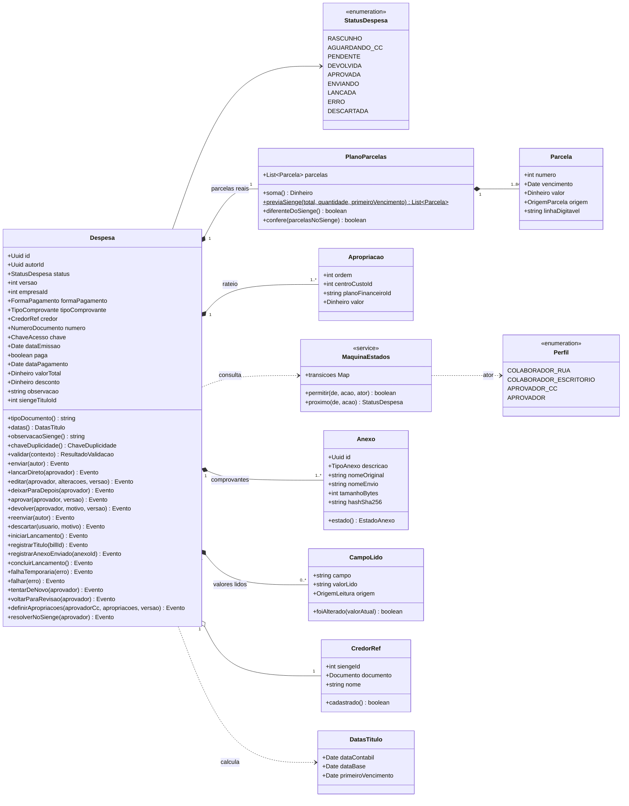
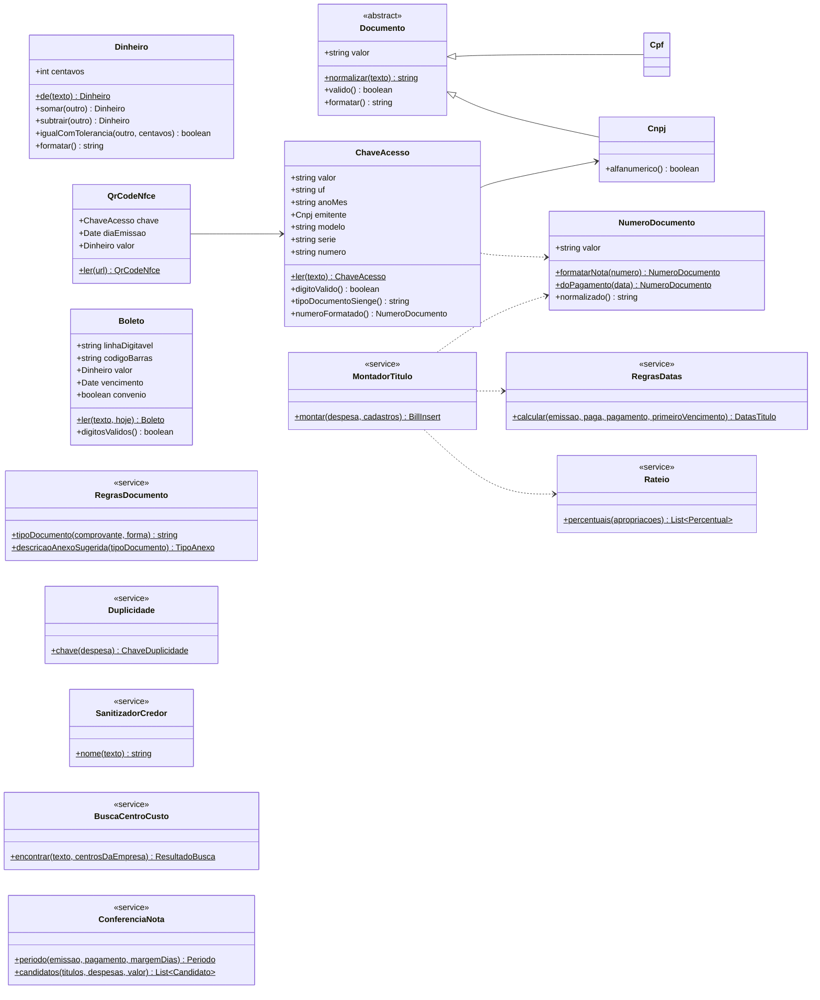
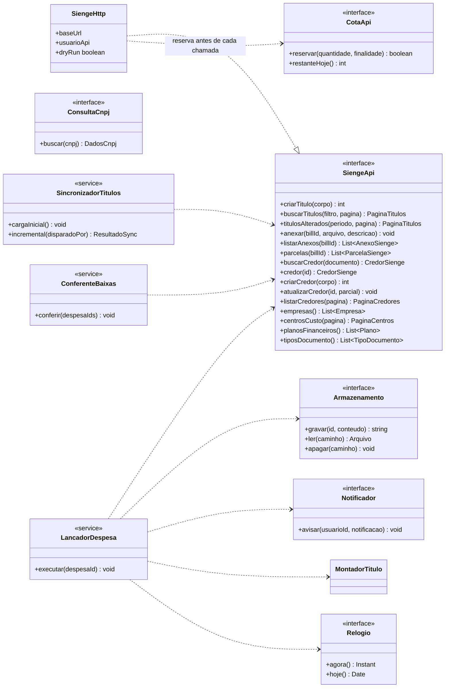

# 04 — Classes

O núcleo de regras fica em `packages/shared`, em TypeScript puro (sem acesso a banco ou rede), e é usado pelos três apps: o PWA valida antes de enviar, a API valida de novo e o worker monta o título. O que fala com o mundo externo fica atrás de **portas** (interfaces), implementadas em `apps/api` e `apps/worker`. Assim, as regras são testáveis sem Sienge, sem banco e sem relógio real.

## 1. Domínio da despesa

`Despesa` é a raiz do agregado: apropriações, parcelas, anexos e campos lidos só mudam por ela, e cada método de transição devolve o `Evento` que a camada de aplicação grava em `eventos_despesa`. As transições permitidas ficam numa tabela única (`MaquinaEstados`), igual à seção 1.2 de [01-estados.md](01-estados.md), para a API e os testes usarem a mesma fonte.

## 2. Valores e regras

### 2.1 Algoritmos (precisos, com os casos reais)

**`NumeroDocumento.formatarNota`** (RN10): remove o que não é dígito e os zeros à esquerda, agrupa de 3 em 3 com ponto e completa o primeiro grupo até 3 dígitos. `000.003.087` → `003.087`; `3072580` → `003.072.580`; `85414` → `085.414`. `normalizado()` (RN09) devolve só os dígitos sem zeros à esquerda; para `dd/mm`, devolve o próprio texto.

**`Rateio.percentuais`** (RN05): para cada linha da 2ª em diante, `percentual = arredondar(valor ÷ soma × 100, 12 casas)`; a 1ª linha recebe `100 − soma das demais`, para a soma dar exatamente 100. Aritmética decimal exata (biblioteca decimal, nunca `number`). Caso real: 365,55 em duas linhas iguais → 182,78 e 182,77 no Sienge.

**`RegrasDocumento.tipoDocumento`** (RN01): o comprovante decide (NF-e/NFC-e → DANF, nota de serviço → NFSE, recibo → REC). Sem comprovante, decide a forma de pagamento: reembolso → REMB (credor indicado pelo usuário ou, sem indicação, o colaborador); cartão ou Pix → PAG (número = data do pagamento); boleto a prazo → PAG (número = data do 1º vencimento).

**`RegrasDatas.calcular`** (RN02): data contábil = emissão; data base = dia 1 do mês da emissão; 1º vencimento = data do pagamento (paga) ou vencimento da 1ª parcela (não paga).

**`Despesa.observacaoSienge`** (RN12): o texto da observação, cortado em 500; vazio → `" "`.

**`MontadorTitulo.montar`**: `indexId 0`; `installmentsNumber` = quantidade de parcelas; `dueDate` = 1º vencimento; `totalInvoiceAmount` = valor + desconto (bruto) e `discount` = desconto; `paymentCategoriesId` sem pontos; `documentIdentificationId` sem espaços; nenhuma informação de parcela além disso (o Sienge divide sozinho).

**`PlanoParcelas.previaSienge`**: valores iguais e vencimentos mensais no mesmo dia do 1º (17.214,96 em 3 → 5.738,32 cada; 19/11, 19/12, 19/01). Vencimentos: o dia do 1º vencimento em todos os meses; se o mês não tiver esse dia, o **último dia do mesmo mês** (31/01 → 28/02 → 31/03; em ano bissexto, 29/02). Nunca passa para o mês seguinte. Se o Sienge gerar outra data, a Camilla ajusta direto no Sienge. Ponto **[spike]**: onde fica o centavo de sobra quando a divisão não é exata. `diferenteDoSienge()` compara com as parcelas reais com tolerância de 1 centavo; `confere()` faz a mesma comparação com as parcelas devolvidas pelo `GET /installments` (ajuste de parcelas).

**`Duplicidade.chave`** (RN09): com chave de acesso, a própria chave; sem chave, (credor ou documento do credor, número normalizado, emissão, valor). É a mesma combinação dos índices únicos de `despesas`.

**`SanitizadorCredor.nome`** (RN13): remove acentos, troca `&` por `e`, remove caracteres especiais, junta espaços repetidos e converte para maiúsculas (padrão dos credores existentes).

**`BuscaCentroCusto.encontrar`** (RN24): normaliza o texto (sem acento, maiúsculas, sem pontuação) e procura só nos centros de custo da empresa da linha, nesta ordem: código exato (`1062`); placa (formato antigo `AAA9999` e Mercosul `AAA9A99`, com ou sem hífen); todas as palavras do texto contidas no nome. Um resultado → `TEXTO`; nenhum ou mais de um → `NAO_ENCONTRADO`.

**`ConferenciaNota.periodo`** (RN23): da menor à maior data entre emissão e pagamento, com a margem em dias antes e depois. `candidatos()` filtra pelo valor com tolerância de 1 centavo.

## 3. Portas de integração

Cada método de `SiengeApi` custa **1 requisição** (paginados: 1 por página). `SiengeHttp` é a única implementação que faz HTTP: reserva a cota antes da chamada, grava `chamadas_api`, normaliza os textos (`trim`), converte datas para o fuso de São Paulo e, com `dryRun` ligado, responde com dados simulados sem chamar o Sienge (padrão em desenvolvimento e homologação). **Não existe** método para alterar título: a interface não oferece `PATCH`/`PUT` de `/bills`, para o bloqueio de títulos de origem `SE` ficar garantido pelo próprio código. `ConferenteBaixas` só entra na versão futura da RN20: na v1, "Já dei baixa" não consulta o Sienge (ADR-0009). `Dinheiro` guarda os centavos num `number` inteiro (ADR-0012).

## 4. Pontos de atenção (precisão)

1. **CNPJ alfanumérico.** A Receita Federal passou a emitir CNPJs com letras nas 12 primeiras posições a partir de julho de 2026 (os dígitos verificadores continuam numéricos; o cálculo converte cada caractere pelo código ASCII menos 48). Consequências: `Cnpj` e as colunas de documento aceitam `[0-9A-Z]`; a normalização remove pontuação mas **não** letras; a chave de acesso de uma NF-e de um emitente novo também pode ter letras nas posições do CNPJ. Confirmar na nota técnica da SEFAZ o cálculo do dígito da chave nesse caso e se a API do Sienge já aceita esses CNPJs.
2. **Fator de vencimento do boleto.** O fator chegou a 9999 em 21/02/2025 e voltou a 1000 em 22/02/2025. `Boleto.ler` precisa da data de hoje (`Relogio`) para escolher o ciclo certo: entre as datas possíveis para o fator, a mais próxima de hoje. Fator `0000` = sem vencimento. Boletos de convênio (48 dígitos, começam com 8) não trazem vencimento no código; o valor só vale se o 3º dígito indicar valor efetivo.
3. **QR code da NFC-e.** A chave é a primeira parte do parâmetro `p` da URL. Na emissão em contingência, o parâmetro também traz o dia da emissão e o valor total (por isso `QrCodeNfce` tem esses campos opcionais).
4. **Dígito verificador da chave.** Módulo 11 com pesos de 2 a 9 da direita para a esquerda sobre as 43 primeiras posições; resto 0 ou 1 → dígito 0.
5. **Dinheiro e percentuais** nunca em ponto flutuante.
6. **Datas do Sienge** chegam sem fuso; tratar como horário de São Paulo antes de gravar como `timestamptz`.
7. **Nome do arquivo** enviado ao Sienge com no máximo 100 caracteres, preservando a extensão.
